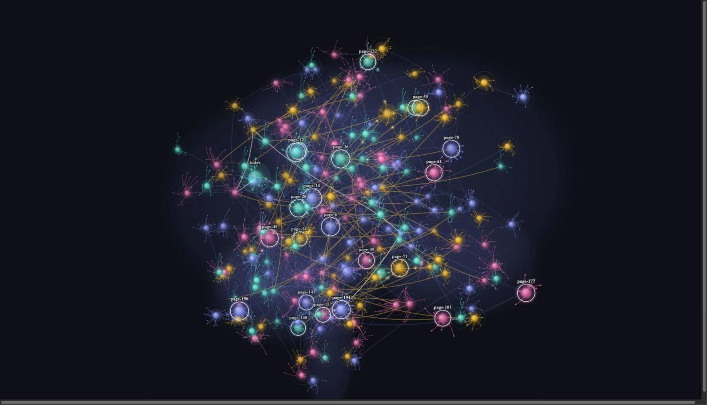

# LLM Wiki Brain

See your wiki as a living 3D brain inside Obsidian. Each page is a neuron, each `[[wikilink]]` is a synapse, and pages that get more links grow bigger. Built for [LLM wikis](https://github.com/jonyfs/llm-wiki-template) (`wiki/sources`, `wiki/entities`, `wiki/concepts`, `wiki/syntheses`), and it works on any vault.



## Features

- **Brain view**: open it from the ribbon icon or the command `LLM Wiki Brain: Open brain view`. Drag to rotate, scroll to zoom at the cursor, `Shift`-drag to pan, pinch on touch screens. Linked pages share a region of the brain.
- **Information flow**: the **Flow** button (or the command) sends a packet from the index along the shortest chain of links to the latest created page, with a trail and one pulse per hop. When the page has no link from the index yet, a dashed arc shows where the link is missing. Pick "latest edited" or "stay in view" in the settings, or use **Flow from index** on any selected page. New pages get a flow automatically.
- **Replay**: the brain empties and the pages return in creation order (or by last edit), each fed from the index. Pause, speed 0.5× to 4×, and a caption with the date, progress and the operations `wiki/log.md` recorded that day.
- **Ambient signals**: small signals keep traveling along links and carry on to neighbors. Off, calm or lively.
- **Selection**: click selects and keeps the selection, with a panel for type, dates, links and neighbors. Double-click or `Enter` opens the note; `Esc` clears. `[` and `]` step through the hubs.
- **Search and Ask**: type to dim everything that does not match; press `Enter` to ask, and the answer spreads two hops along the links.
- **Filters**: page type, folder, tag, minimum links, edited in the last N days, orphans only, or only the neighborhood of the selected page. Filters are saved with the pane.
- **Lint**: orphan pages, pages with broken links and pages without a type get a dashed ring, with a clickable list.
- **A neuron, not a dot**: an irregular cell body pulled toward its main dendrites, branches that narrow and fork, spines on the thin ones, an axon with a cone and terminal boutons. Each link leaves through a free dendrite pointing toward the other page and ends in a bouton; busy hubs grow extra branches; free branches stay faint. Four shapes, one per page type. "Neuron detail" in the settings: Auto (lowers detail when frames get slow), High, or Simple.
- **Follows you**: open a note and its neuron is selected and centered. Hover a neuron for the note preview (Page Preview core plugin, with its usual modifier key).
- **Neuron model**: a link is a synapse. It leaves through the axon of the page that holds it and lands on a dendrite of the page it points to; signals only travel that way. Each page adds up what arrives, leaks charge over time and fires all-or-nothing at a threshold (the arc around the soma shows how close it is). Ask follows outgoing links, so a page fed by several matches fires. Links used together grow stronger and fade when idle.
  - **Inhibition**: a frontmatter link under `contradicts`, `contradiz`, `contradice`, `contredit`, `conflicts`, `refutes` or `disputes` inhibits: its spikes are red and lower the target's charge instead of raising it.
  - **Myelin**: links between busy pages conduct faster, in jumps like the nodes of Ranvier.
  - **Attention**: the `Attention` button in a page's panel shows, for a moment, the most similar pages it does not link to (dashed arcs, brighter = heavier weight).
- **Search syntax**: words, `path:`, `file:`, `tag:` (nested tags too), `type:`, `heading:` and `-` to exclude, for example `path:concepts tag:ai -type:source`. Quotes keep phrases together: `path:"my folder"`.
  - `or` joins alternatives: `tag:ai or tag:ml`.
  - `links:>3`, `links:0` compare the number of links.
  - `created:<7d`, `edited:>30d`, `edited:>2026-01-01` take an age (`d`, `w`, `m`, `y`) or a date.
  - `prop:status=draft`, `prop:author~ana`, `prop:status` read frontmatter (equals, contains, exists).
  - `is:orphan`, `is:broken`, `is:untyped`, `is:index`, `is:log`, `is:hub`.
  - With no match, a single word falls back to fuzzy file names. Enter again (or `›`/`‹`) walks the matches; `Copy` puts them on the clipboard as `[[links]]`.
- **Filters**: also created-in-last-N-days, maximum links, neighbourhood depth 1 to 3, and invert.
- **Opens as you left it**: neuron positions are saved, so the brain does not re-settle on every start.
- Works on desktop and mobile. No network access, no telemetry, no dependencies. Pauses when the pane is hidden and lowers detail when frames get slow.

## Languages

English (default), Portuguese (Brazil), Spanish and French. The plugin follows Obsidian's own language; pick another one in the plugin settings (Language). Other Obsidian languages show English. To add a language, copy a block in `src/i18n.ts`; the tests check that every key and every `{placeholder}` is present.

## Page types

The type comes from, in order: the `type` frontmatter field (`source`, `entity`, `concept`, `synthesis`), a parent folder with one of those names, or a stable guess from the folder name.

## Settings

- **Wiki folder** (default `wiki`): only pages inside it become neurons. Empty means the whole vault.
- **Maximum pages** (default 800): larger vaults keep the most connected pages and the index.
- **Ambient signals**, **Flow speed**, **Flow target**, **Flow stays in view**, **Flow to new pages**.
- **Reduce motion**: settle the layout instantly and stop the slow rotation.

## Install

From the community directory: Settings → Community plugins → Browse → search "LLM Wiki Brain".

Beta with [BRAT](https://github.com/TfTHacker/obsidian42-brat): add `jonyfs/llm-wiki-brain`.

Manual: download `main.js`, `manifest.json` and `styles.css` from the latest release into `<vault>/.obsidian/plugins/llm-wiki-brain/`.

## Development

```bash
npm install
npm run dev     # watch build
npm run build   # type-check and production build
npm test        # route finder and lobe assignment tests
```

Release: bump the version with `npm version patch|minor|major`, push the tag; the GitHub Action attaches `main.js`, `manifest.json` and `styles.css`.

## Credits

The brain engine is ported from the [llm-wiki-template](https://jonyfs.github.io/llm-wiki-template/#graph) demo graph. MIT licensed.
